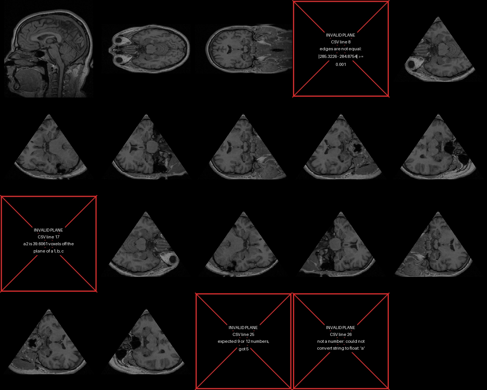

# Ex1 – Plane projection of a 3D volume

Introduction to Software Engineering (OOP / OOD), Ariel University.



## The problem
Given a 3D raster matrix **M** (`sx × sy × sz` unsigned integer values of 8, 16 or 32 bits,
`1 <= sx, sy, sz < 2^10`) and a plane **p**, compute the 2D image **E** of the cut of M
along p – like the X / Y / Z sections in 3D Slicer, but for *any* plane.

The plane is given by **3 points** `a, b, c` forming an isosceles triangle
(`|dist(a,b) - dist(a,c)| < 0.001`) or **4 points** `a1, a2, b, c` forming an isosceles
trapezoid. Any point of the triangle/trapezoid that lies inside M is copied to E using
the closest voxel; points outside M are 0.

## Scope
* **In:** NRRD reader, plane validation, a fast projection (≥ 30 FPS on 500³, measured
  ≈300 FPS), the demo `Ex0.py` that makes an MP4 from a CSV of planes (with error frames
  for invalid planes), tests, benchmark, documents.
* **Out:** GUI, interpolation / super-resolution, physical (mm) coordinates.

Full details: [SRS](docs/SRS.md).

## Documents
| Document | Content |
|---|---|
| [docs/SRS.md](docs/SRS.md) | Software Requirements Specification |
| [docs/ALGORITHM.md](docs/ALGORITHM.md) | The algorithm in detail, and how it was made fast |
| [docs/DATASET.md](docs/DATASET.md) | The NRRD data set |
| [docs/TESTING.md](docs/TESTING.md) | Testing strategy |
| [docs/EXPERIMENT.md](docs/EXPERIMENT.md) | Experiment, results, benchmark |

## How to install and run
Requires Python 3.10+.
```bash
git clone <this repo> && cd <repo folder>
pip install -r requirements.txt

# the demo (required format: python Ex0.py file.nrrd file.csv file.mp4)
python Ex0.py data/MRHead.nrrd examples/mrhead_planes.csv results/mrhead_planes.mp4

# tests and benchmark
python -m pytest -q
python benchmark.py

# optional: regenerate the synthetic data set and the example CSV
python scripts/make_dataset.py
python scripts/make_example_csv.py
```
`Ex0.py` accepts `--fps N` for the video speed (default 5 frames per second).

### CSV format
One plane per row, in voxel coordinates `(x, y, z)`:
```
# triangle a, b, c (9 numbers)
127.5,0,64.5, 0,255,64.5, 255,255,64.5
# trapezoid a1, a2, b, c (12 numbers)
0,0,64.5, 255,0,64.5, 0,255,64.5, 255,255,64.5
```
Lines starting with `#` and empty lines are ignored. A row that is not a valid plane
becomes a black **error frame** with a red X and the reason; the other rows are not affected.

## Design
```
Ex0.py                 demo: CSV -> projections -> MP4
projection/
  nrrd_reader.py       read_nrrd / write_nrrd     -> Volume
  volume.py            class Volume      the matrix M; sample_nearest()
  plane.py             class Plane       validated 3/4-point plane (raises InvalidPlaneError)
  projector.py         class Projector   Projector(volume).project(plane) -> image E
  plane_csv.py         read_plane_csv    -> list of PlaneRow (plane or error + line number)
  video_writer.py      gray scaling, canvas, error frame, MP4 writing
  errors.py            InvalidPlaneError, NrrdFormatError, PlaneCsvError
tests/                 49 pytest tests
benchmark.py           FPS on a 500^3 volume
scripts/               data set and example CSV generators
data/  examples/  results/  docs/
```
Each class has one job: `Plane` knows whether it is valid, `Volume` knows how to read
its voxels, `Projector` knows the algorithm, `Ex0.py` only connects them. The library
raises exceptions; the demo decides what to show for them (error frames).

## Results (short)
* All 49 tests pass.
* 500³ volume: **≈300 projections per second** (requirement 30, target 100).
* The fast version gives the same image as a literal implementation of the
  lecturer's loop.
* Demo video: [results/mrhead_planes.mp4](results/mrhead_planes.mp4) – see
  [EXPERIMENT.md](docs/EXPERIMENT.md).

## AI usage
As required by the course AI policy: this project was developed with the help of an
AI coding assistant (Claude). All code was reviewed, run and tested.
